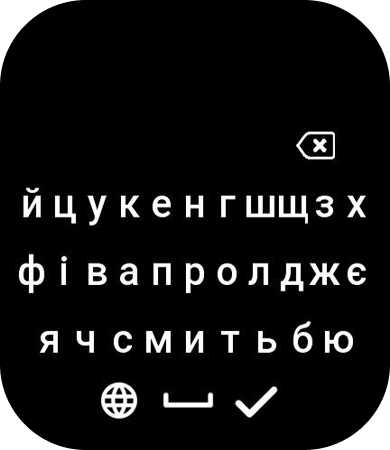
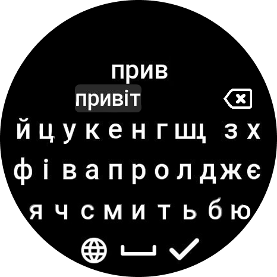

# Українська клавіатура для Zepp OS (API 4.2)

   

Кастомна українська клавіатура для годинників на платформі **Zepp OS**. Працює з **API 4.2** та інтегрується в системні поля вводу (відповіді на повідомлення тощо). У проєкт додано скриншоти інтерфейсу та іконку застосунку.

# Особливості
- Підтримка вводу українською мовою (розкладка ЙЦУКЕН, довге натискання г→ґ та і→ї).
- Підказки типу Т9, формуються з міні-словника проєкту — **~120 слів**.

# Швидке встановлення вихідного коду
Відкрийте термінал і виконайте:

```bash
git clone <URL-цього-репозиторію>
cd zeppos-ukrainian-keyboard
```

Далі встановіть `zeus` CLI згідно з офіційною інструкцією:
[https://docs.zepp.com/docs/guides/tools/cli/](https://docs.zepp.com/docs/guides/tools/cli/)

Після встановлення `zeus` виконайте підготовку файлу (розпакування node_modules):

```bash
python3 preapre_all.py
```

# Збірка та встановлення на пристрій

Якщо ви редагуєте код під себе, для встановлення на пристрій використовуємо команду:
```bash
zeus preview
```

# Подяки

Дякуємо автору `silver-zepp` — зразку, на який спирався цей проєкт:
[https://github.com/silver-zepp/zeppos-samples/tree/main/application/4.2/simple-keyboard](https://github.com/silver-zepp/zeppos-samples/tree/main/application/4.2/simple-keyboard)
